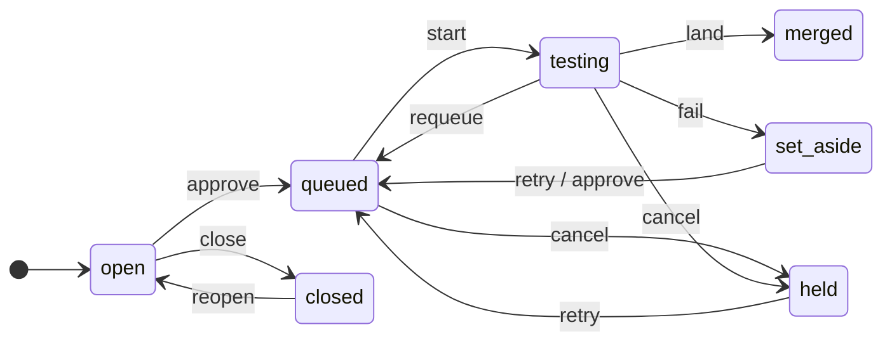

# Forgejo service
{: .no_toc }

`murasame serve` runs the queue as a bot for Forgejo or Gitea. Reviewers queue
pull requests with comments; murasame gates them and pushes what passes.

1. TOC
{:toc}

## Setup

Add `[forgejo]` to the project config (or use a [multi-repo config](multi-repo.html)):

```toml
[forgejo]
url = "https://forge.example.com"
owner = "team"
repo = "app"
git_remote_url = "https://forge.example.com/team/app.git"
reviewers_from_permission = "write"
```

```sh
export MURASAME_FORGEJO_TOKEN=...
murasame check-config                  # shows who can approve
murasame serve --repo /var/lib/murasame/app.git
```

murasame polls every `poll_interval` seconds, so a webhook is optional. Pointing
one at `POST /webhook` makes it react immediately; set `MURASAME_WEBHOOK_SECRET`
to verify signatures.

The bot user needs write access to the repository and a token with
`write:repository`, `write:issue` and `read:user`. Protect the target branch so
only the bot can push or merge. [Deployment](deployment.html) covers a full
server install.

## Permissions

`approve`, `unapprove`, `retry`, `cancel`, `priority` and `rollup` need a
reviewer: a user in `reviewers`, or anyone with at least
`reviewers_from_permission` on the repository. With neither set, nobody can
approve.

Anyone can use `status` and `ping`. Non-reviewers get at most one reply per
`reply_cooldown` seconds.

Commands in an edited comment are ignored, since anyone with write access can
edit comments. Post a new comment instead.

## Commands

Comment `@murasame <command>` on a pull request:

| Command | Effect |
|---|---|
| `approve SHA` | Queue the PR at this head. The full 40- or 64-character SHA is required. |
| `unapprove` | Remove the approval and dequeue. |
| `retry` | Requeue after a set-aside or cancel. |
| `cancel` | Stop its test or leave the line, keeping the approval (`held`). |
| `priority N` | -9999 to 9999; higher goes first. |
| `rollup` / `rollup never` | Allow batching (default) / always gate alone. |
| `status` | Report the PR's state. |
| `ping` | Check the bot is listening. |

The approval names a commit so it can't apply to code pushed later. If the head
has moved, the bot refuses and quotes the current head. Any push to a queued PR
sends it back to `open`.

For unknown commands, the bot suggests the closest match. It recognises common
variants such as `lgtm` or `r+` (approve), `abort` (cancel), `rerun` (retry)
and `p=5` (priority 5).

## PR states



| State | Meaning |
|---|---|
| `open` | Not approved. |
| `queued` | Waiting in line. |
| `testing` | In the running batch. |
| `set_aside` | Failed or conflicted. |
| `held` | Cancelled, approval kept. |
| `merged` | Landed, by murasame or otherwise. |
| `closed` | PR closed. |

`unapprove` or a push returns any active state to `open`.
`murasame history --pr N` shows a PR's transitions.

## Batches

The line is sorted by priority (highest first), then approval time, then PR
number. Each cycle takes up to `batch_max` PRs from the front, stopping at a
`rollup never` PR, and gates them as a [batch](how-it-works.html#batches-and-bisection).

During a gate, murasame checks the batch's PRs every `poll_during_gate` seconds,
so a cancel, unapprove or push stops it quickly. After an infrastructure
failure the queue pauses for `infra_backoff` seconds; `status` shows why.

## Feedback

- Commit statuses under `status_context`: pending, then success or failure.
- Comments when a PR is queued, lands, is set aside (with the last
  `log_excerpt_lines` of the gate log) or is cancelled. `comment_on_start` adds
  one when testing starts.
- With `mark_merged` (default on), the PR is marked merged after landing.

## HTTP endpoints

The server listens on `listen` (default `127.0.0.1:8737`).

| Route | Purpose |
|---|---|
| `POST /webhook` | Webhook receiver. |
| `GET /` | Status page (HTML). |
| `GET /api/status` | Status (JSON). |
| `GET /repos/NAME/logs/LOG` | A gate log. |
| `GET /healthz` | Liveness. |

The status page has no login. It only answers requests addressed to a loopback
host name or to `external_url`'s host; anything else gets 403. See
[Status page](deployment.html#status-page).

The token and webhook secret are removed from the environment of gates, hooks
and conflict commands, and the token is redacted from logs. Those commands
still run as the same user, though; see [Isolation](deployment.html#isolation).
