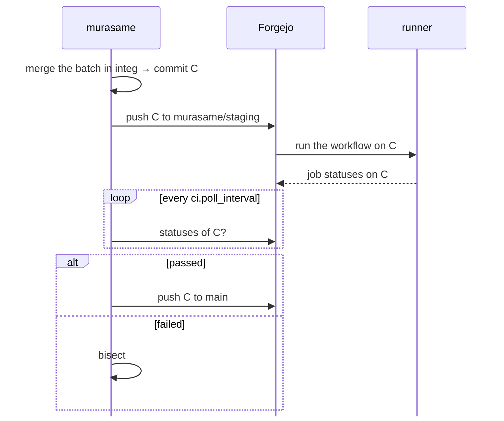

# Gates
{: .no_toc }

The gate is Forgejo Actions. murasame pushes each merged result to a staging
branch and lands it only if the CI statuses on that commit pass.

1. TOC
{:toc}

## How a gate runs



What lands is the commit CI tested.

```toml
[ci]
staging = "murasame/staging"
contexts = ["ci / check (push)", "ci / lint (push)"]
timeout = 3600          # no result after this: infrastructure failure
start_timeout = 900     # no status at all after this: infrastructure failure
poll_interval = 15
```

All keys are in the [configuration reference](configuration.html#ci).

## The workflow


```yaml
name: ci
on:
  push:
    branches: [murasame/staging]
  pull_request:
concurrency:
  group: ${{ github.workflow }}-${{ github.ref }}
  cancel-in-progress: true
jobs:
  check:
    runs-on: docker
    steps:
      - uses: actions/checkout@v4
      - run: timeout 30m make check
```


Forgejo reports one status per job, named `<workflow> / <job> (<event>)`: here
`ci / check (push)`. The `concurrency` block cancels a run once murasame has
pushed a newer commit to the staging branch, since murasame only waits for the
last one.

The bot user pushes the staging branch, so it needs write access (it has that
to land PRs anyway), and the staging branch must not be protected.

## Verdicts

murasame looks at the newest status of each context, counting only statuses
of a run started after its push: a commit can already carry statuses, for
example a PR's head that the queue fast-forwards to, or a commit gated before.
Statuses that existed before the push, and later ones linking to the same run,
don't count. With
`contexts` set, only those count; with `contexts = []`, every new status
counts, except murasame's own (`forgejo.status_context`).

If the staging branch already points at the commit, a push changes nothing and
starts no run, so murasame deletes the branch and pushes it again.

| Statuses | Verdict | Result |
|---|---|---|
| all `success` or `warning` | pass | The batch lands. |
| any `failure` or `error`, or a required context `skipped` after another job failed | fail | The batch is bisected; a single PR is set aside. |
| a required context `skipped` with no job failed | infrastructure failure | The workflow skipped it (`if:` or path filters): the batch goes back in the queue. |
| a job cancelled, and none failed | infrastructure failure | Not a test result: the batch goes back in the queue. |
| `contexts = []` and every job `skipped` | infrastructure failure | Nothing was tested: the batch goes back in the queue. |
| no status after `start_timeout` | infrastructure failure | The batch is put back in the queue, and the queue pauses for `infra_backoff`. |
| a context in `contexts` never reported, `start_timeout` after the rest finished | infrastructure failure | The message names the contexts the run did report: usually a typo in `contexts`. |
| no decision after `timeout` | infrastructure failure | The same. |
| statuses unreadable 5 times in a row, or the push refused | infrastructure failure | The same. |

A failure ends the wait at once, even while other jobs are still running.

Forgejo creates a run's statuses as soon as the push arrives, as pending
"Waiting to run", even with no runner online. So a missing runner is not caught
by `start_timeout` but by `timeout`, whose message then says the jobs never
started. Keep `timeout` within what you are willing to wait.

A cancelled job reports `failure` with the description "Has been cancelled".
murasame never cancels the run it waits for, so a cancel comes from a person or
from another push to the staging branch: it is an infrastructure failure, and
the batch goes back in the queue. A real failure in another counted job still
fails the gate.

{: .warning }
Forgejo 15 with runner 9 does not enforce a job's `timeout-minutes`. A test
that hangs runs until `ci.timeout`, which is an infrastructure failure: the
batch is retried and the PR never set aside. Put a time limit in the step
itself, for example `run: timeout 30m make check`, so a hang fails the job.

A job skipped by an `if:`, or because a job it `needs` failed, didn't run.
Forgejo 15 reports it as `success` with the description "Has been skipped";
later versions report `skipped`. murasame treats both as skipped. For a
context in `contexts`, a skip never passes the gate, since the job didn't test
the commit: it fails the gate when another job failed, and is an
infrastructure failure otherwise. With `contexts = []`, skipped jobs don't
block as long as at least one job ran.

Forgejo doesn't write a status that repeats the newest one of its context. If
an earlier run on the same commit is still waiting with the same description,
the new run's first status may only appear once a job changes state; keep
`start_timeout` above the time a job waits for a runner.

{: .note }
With `contexts = []`, murasame passes the commit as soon as every status
reported so far has finished. Forgejo creates the statuses of all jobs of a run
when the run starts, so one workflow is safe; with several workflows on the
staging branch, one may finish before another starts. List the jobs in
`contexts` then.

## Gate logs

Each gate writes a short log to `state_dir`, such as
`20261121-091445-batch-pr-12+2.gate.log`, with the statuses it saw and their
links to the Actions runs. The status page serves these logs, and comments on
set-aside PRs quote the failing status with its link.

## Secrets

A push to the staging branch runs the workflow with the repository's Actions
secrets. Only approved PRs reach the staging branch, so a reviewer's
approval is what lets a PR's code run with them, as with any merge queue.

## Pass records

With records enabled, murasame stores every tree that passed CI. If the same
tree comes up again (for example, after a batch was stopped just before it
landed), it lands without another CI run.

```toml
[records]
enabled = true
max_age = 172800    # seconds; default 2 days
```

A record matches when the git tree hash is the same and `ci.contexts` is
unchanged. The workflow files are part of the tree, so changing them changes
the tree.

Within a run, murasame also remembers failed trees, so bisection never sends
the same tree to CI twice.
