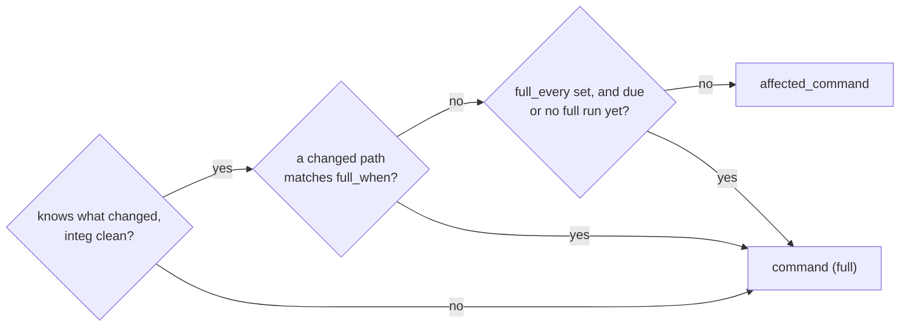
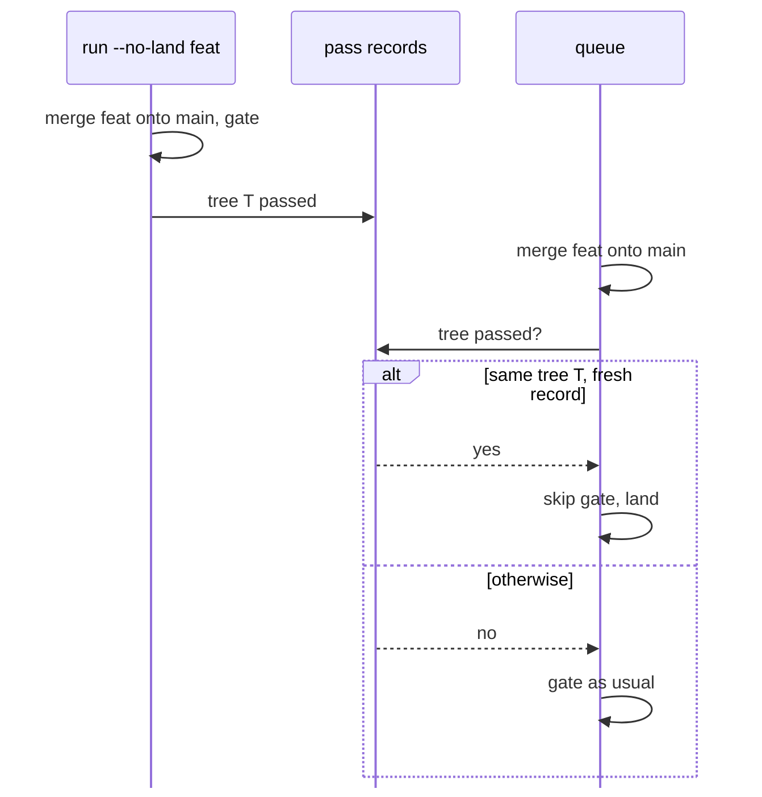

# Gates
{: .no_toc }

A gate is the command that decides whether a merged tree may land. It runs in
`integ` after the merges.

1. TOC
{:toc}

## Defining gates

Each `[gates.<name>]` table is a gate. You need at least one.

```toml
[gate]
default = "check"       # required with more than one gate
timeout = 7200          # default timeout for all gates, seconds
env = { CI = "1" }      # env for all gates

[gates.check]
command = ["sh", "-c", "make check || exit 1"]
timeout = 3600
retries = 1
retry_wait = 30
env = { GOFLAGS = "-count=1" }

[gates.build]
command = ["make", "build"]
```

Pick a gate per run with `murasame run --gate build`. All keys are in the
[configuration reference](configuration.html#gates).

The gate's environment is murasame's, plus `[gate] env`, plus the gate's `env`.
Output goes to the terminal and to a log in `state_dir`, such as
`20261121-091445-batch-feat-a+2.gate.log`.

Gate commands and env values can use these placeholders:

| Placeholder | Value |
|---|---|
| `{repo}` | The main checkout. |
| `{state_dir}` | The state directory. |
| `{integ}` | The integration tree (the working directory). |
| `{target}` | The target branch. |
| `{gate}` | The gate's name. |
| `{retried}` | `1` on a retry, else `0`. |
| `{base}` | The commit the branches were merged onto. |

## Exit codes

| Exit | Verdict | Result |
|---|---|---|
| 0 | pass | The tree may land. |
| 1 | fail | The branch is at fault: set aside (batch) or the run stops (one by one). |
| other | infrastructure failure | Retried. If every attempt fails, the run stops and no branch is blamed. |

Timeouts, commands that can't start (including exit 127), signals, and gates
that leave processes running also count as infrastructure failures.

{: .warning }
`make` exits 2 when a target fails, so a bare `["make", "check"]` turns every
test failure into an infrastructure failure and stops the queue. Use
`["sh", "-c", "make check || exit 1"]` or make your test runner exit 1.

### Retries

`retries` (default 1) applies only to infrastructure failures, `retry_wait`
seconds apart (default 30). Exit 1 is never retried.

```text
-- infrastructure failure, not a test result (check: exit 2): retry 1 of 1 in 30 s
MERGE QUEUE STOPPED at feat-c: the check gate did not give a result in 2 attempt(s) (exit 2; log: ...)
```

`{retried}` lets the gate tell it is on a retry, for example to clear a cache.

## Pass records

With records enabled, murasame stores every passing tree. If the same tree
comes up again for the same gate config, the gate is skipped.

```toml
[records]
enabled = true
max_age = 172800    # seconds; default 2 days
```

A record matches when the git tree hash is the same and the gate's name,
`command`, `env`, `[gate] env` and `command_prefix` are unchanged. `timeout`
and `retries` don't count. `run --regate` ignores records.

Within a run, murasame also remembers failed trees, so bisection never gates the
same tree twice.

## Affected tests

A gate can have a cheaper second command that runs only the tests the change
can affect, as chosen by your build tool:

```toml
[gates.check]
command = ["make", "check"]
affected_command = ["make", "check-affected", "BASE={base}"]
full_when = ["go.mod", "go.sum", "Makefile", "ci/**"]
full_every = 20                       # needs [records]
```

Inside `integ`, `git diff --name-only {base}` lists the change. For each tree:



The gate log says which and why, and `merges.log` marks those merges
`scope=affected`. An affected-tests pass never counts as a full-run record.

Full runs are still needed: dependency graphs miss generated code, fixtures and
files read at run time, and `{base}` may itself have had only an affected run.

## Gating ahead: `--no-land`

`murasame run --no-land BRANCH` gates one branch as the queue would and records
the pass instead of landing.

It merges the branch onto the current target in its own throwaway worktree
(`{state_dir}/no-land-<pid>`), with the same conflict rules, hooks, gate and
environment. It skips the queue lock, so it can run alongside the queue. It
needs records enabled and takes exactly one branch.



The tree differs if the target has moved or the branch is batched with others.
The skip message names the `…-no-land-<branch>.gate.log` it came from.

For the Forgejo service, run it on the server with the service's config so the
record lands in the service's database.

{: .warning }
No-land gates run alongside the queue's gate as the same user. Gates that use
fixed ports, shared caches or fixed paths outside the worktree can collide.
