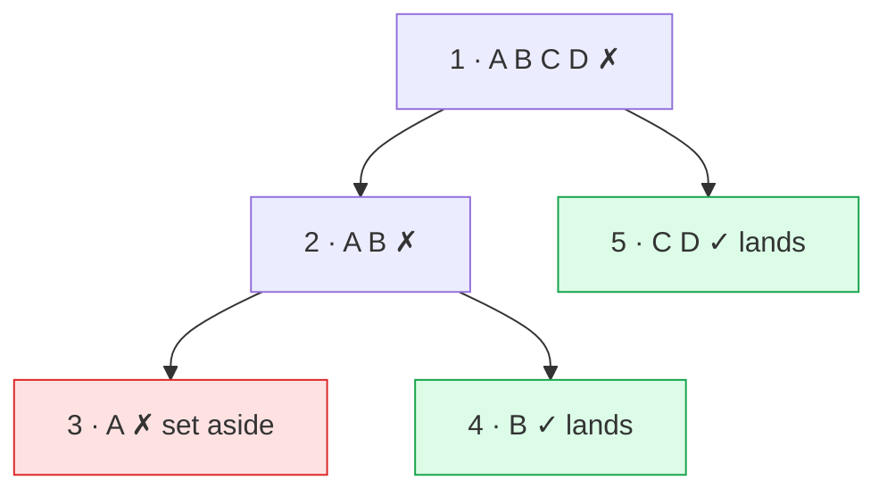

# How it works
{: .no_toc }

1. TOC
{:toc}

## The integration tree

The target is the first branch in `[repo].target` that exists, so
`["main", "master"]` works for repositories with either.

murasame never merges on the target directly. It works in the integration tree
(`integ`, default `{state_dir}/integ`), a detached worktree of the same
repository. For each gate run it:

1. resets `integ` to the target;
2. merges the branches in order, applying [conflict rules](conflicts-and-hooks.html#conflict-rules)
   and [post-merge hooks](conflicts-and-hooks.html#post-merge-hooks);
3. runs the [gate](gates.html) in `integ`;
4. if the gate passes, fast-forwards the target to `integ`'s `HEAD`.

Before landing, murasame checks that `integ` still holds the exact tree the gate
saw. If anything was committed or changed during the gate, it refuses to land.

With `create_integ = true` murasame creates the worktree. Otherwise:

```sh
git worktree add --detach .murasame/integ main
```

murasame won't start if `integ` has the target checked out, has uncommitted
changes or untracked files, or has commits not on the target. A half-built
`integ` left by an interrupted run is reset automatically.

Landing differs by mode:

- `murasame run` fast-forwards the target in the main checkout with
  `git merge --ff-only`. That checkout must be on the target branch. Nothing is
  pushed.
- The Forgejo service pushes the gated commit to the forge.

With `[merge] no_ff = true`, each branch gets a merge commit even when a
fast-forward is possible.

## Batches and bisection

In batch mode (`batch = true` or `--batch`) murasame merges every branch and
runs the gate once. If it passes, they all land.

If it fails, murasame splits the batch in half, gates the first half, then the
second half on top of whatever landed, and repeats until each failing group is
one branch. One bad branch among N costs about log₂ N extra gate runs.



A branch that fails alone is set aside: it doesn't land, the reason goes to
`merges.log`, and the queue continues. A branch with a conflict that no rule
resolves is also set aside (`SET ASIDE x2: merge conflict that needs a person: a`).

### The pair check

Some branches pass alone but fail together. With `pair_check = true` (the
default), when a branch fails on top of others that landed earlier in the run,
murasame also gates it alone on the original target. This run is for diagnosis
and never lands. The set-aside message then says whether the branch is broken
on its own or only next to the named partners. Set `pair_check = false` to skip
the extra run.

## One by one

With `--one-by-one` (or `batch = false`) each branch is merged and gated
separately, in order. The first failure or unresolved conflict stops the run:

```text
MERGE QUEUE STOPPED at feat-bad: the gate failed (check; log: ...)
  integ is reset to main (9f8da37); main has every branch merged before it
```

## Outcomes

| Outcome | Meaning |
|---|---|
| `merged` | Landed on the target. |
| `skipped` | Already in the target. |
| `set_aside` | Failed the gate or couldn't merge; the run continued without it. |
| `stopped` | The run stopped at or before this branch. |

In either mode, these stop the run:

- an [infrastructure failure](gates.html#exit-codes) on every retry;
- a cancel (Ctrl-C, or `@murasame cancel`);
- the target or `integ` changing during the run.

`integ` is always reset to the target afterwards. The target holds only what
landed before the stop.

## Files

Everything lives in `state_dir` (default `.murasame`):

| Path | Contents |
|---|---|
| `integ/` | The integration worktree. |
| `merges.log` | One line per merge, batch, set-aside and stop. |
| `*.gate.log` | One log per gate run. |
| other logs | Post-land hooks and conflict commands. |
| `murasame.sqlite3` | Run history, pass records, service state. |
| `no-land-<pid>/` | Temporary worktrees for `run --no-land`. |

A lock in `state_dir` lets only one run use `integ` at a time. A second
`murasame run` waits for it. If `[repo] lock_wait` is set, it gives up after
that many seconds and exits 1; the default, 0, waits indefinitely.
`--dry-run` and `--no-land` use their own worktrees and skip the lock.
