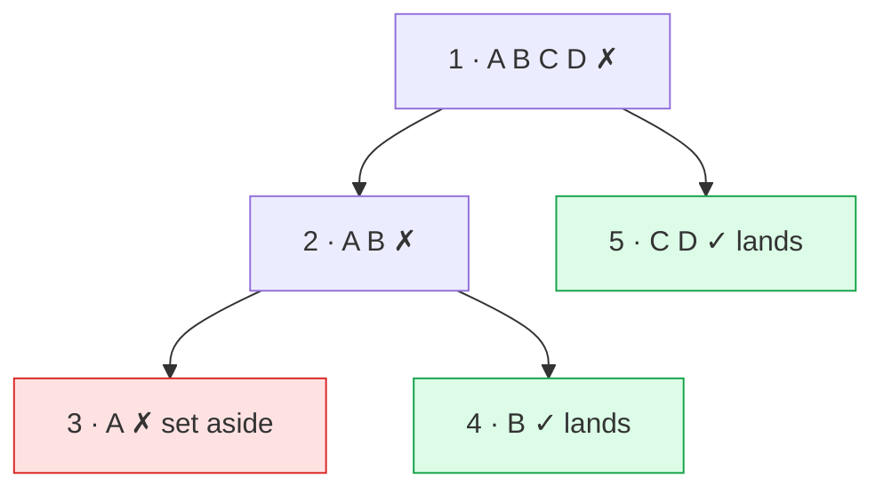

# How it works
{: .no_toc }

1. TOC
{:toc}

## The integration tree

The target is the first branch in `[repo].target` that exists, so
`["main", "master"]` works for repositories with either.

murasame never merges on the target directly. It works in the integration tree
(`integ`, default `{state_dir}/integ`), a detached worktree of its bare clone.
For each gate run it:

1. resets `integ` to the target;
2. merges the PRs in order, applying [conflict rules](conflicts.html);
3. pushes `integ`'s `HEAD` to the staging branch and waits for
   [CI](gates.html);
4. if CI passes, pushes that same commit to the target on the forge.

Before landing, murasame checks that `integ` still holds the commit CI tested,
and checks every PR's approval again. If anything changed, it refuses to land.
murasame creates the worktree itself and resets one left half-built by an
interrupted cycle.

With `[merge] no_ff = true`, each branch gets a merge commit even when a
fast-forward is possible.

## Batches and bisection

murasame merges every PR of a batch (at most `batch_max`) and runs the gate
once. If it passes, they all land.

If it fails, murasame splits the batch in half, gates the first half, then the
second half on top of whatever landed, and repeats until each failing group is
one branch. One bad PR among N costs about log₂ N extra CI runs.

A PR that fails alone is set aside: it doesn't land, the reason goes to
`merges.log`, and the queue continues. A PR with a conflict that no rule
resolves is also set aside (`SET ASIDE x2: merge conflict that needs a person: a`).

### The pair check

Some branches pass alone but fail together. With `pair_check = true` (the
default), when a branch fails on top of others that landed earlier in the run,
murasame also gates it alone on the original target. This run is for diagnosis
and never lands. The set-aside message then says whether the branch is broken
on its own or only next to the named partners. Set `pair_check = false` to skip
the extra run.

## Outcomes

| Outcome | Meaning |
|---|---|
| `merged` | Landed on the target. |
| `skipped` | Already in the target. |
| `set_aside` | Failed the gate or couldn't merge; the run continued without it. |
| `stopped` | The run stopped at or before this PR; it goes back in the queue. |

These stop the run:

- an [infrastructure failure](gates.html#verdicts): no CI status, no result in
  time, or a refused push;
- a cancel (`@murasame cancel`, `unapprove`, or the service stopping);
- the target or `integ` changing during the run.

`integ` is always reset to the target afterwards. The target holds only what
landed before the stop.

## Files

Everything lives in `state_dir` (default `.murasame`):

| Path | Contents |
|---|---|
| `integ/` | The integration worktree. |
| `merges.log` | One line per merge, batch, set-aside and stop. |
| `*.gate.log` | One log per gate: the CI statuses murasame saw, with links to the runs. |
| `murasame.sqlite3` | Run history, pass records, service state. |
| `.service.lock` | Lets only one murasame process run a cycle of the repository at a time. |
